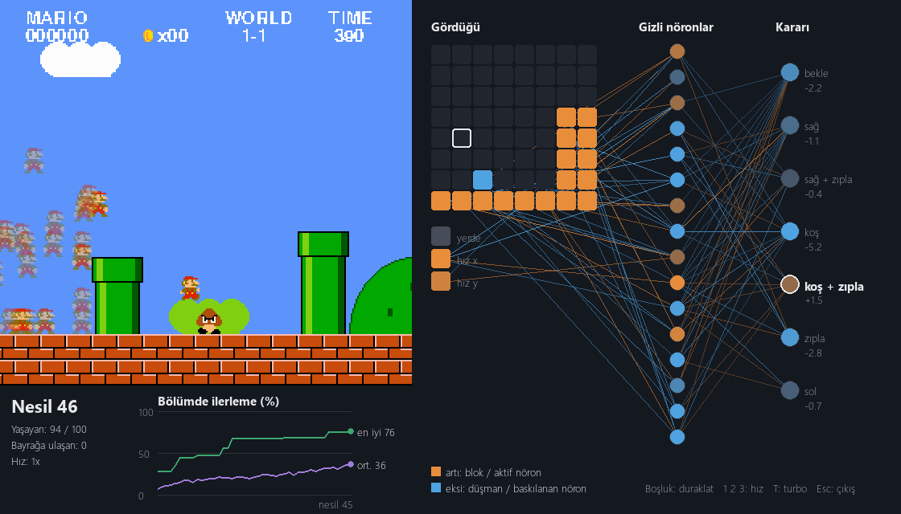

# Mario AI

100 Marios learn to beat World 1-1 through trial, error, and evolution, and you can watch their neurons fire while it happens.



The game, physics, and neural network code are written in Python, with no ROM, emulator, or machine learning framework.

## How it works

Nobody tells Mario how to play. Each generation repeats four steps:

1. **Play:** 100 Marios attempt the level at the same time, each with its own small, randomly different brain.
2. **Score:** Each Mario gets a score based on how far it got, how long it took, and whether it reached the flag.
3. **Select:** The 30 best brains become parents. The very best one passes to the next generation unchanged.
4. **Mutate:** The other 99 Marios are parent copies with small random changes to their connection weights.

Most mutations make Mario worse. Occasionally one gets him over an obstacle, and that brain spreads through the next generations.

### The brain

| Layer | Neurons | Meaning |
| --- | --- | --- |
| Input | 67 | An 8x8 window around Mario (block `+1`, enemy `-1`, empty `0`), plus on-ground, horizontal speed, and vertical speed |
| Hidden | 16 | `tanh` activation |
| Output | 7 | One score per button combination; the highest one is pressed |

Mario makes a new decision every 4 frames.

### The score

```python
score = max_x - frames * 0.1
if flag_get:
    score += 5000
```

Distance matters most, a small time penalty favors the faster of two equal runs, and the flag bonus outweighs everything else.

## Results

With the settings above (100 Marios, 30 parents, mutation size `0.1`), two headless test runs reached the flag:

| Seed | Generation reaching the flag | Training time |
| --- | --- | --- |
| 0 | 54 | 30 seconds |
| 1 | 84 | 60 seconds |

Evolution is random, so your run will differ. Training also takes longer with the window open at normal speed; press `T` for turbo.

## Getting started

Tested with Python 3.13.

```bash
git clone https://github.com/bera61/mario-ai.git
cd mario-ai
pip install -r requirements.txt
```

**Train and watch the neurons:**

```bash
python train.py
```

**Replay the best saved brain** (available after training):

```bash
python train.py --watch
```

**Play the level yourself:**

```bash
python play.py
```

### Controls

| `train.py` | |
| --- | --- |
| `Space` | Pause |
| `1` `2` `3` | Speed 1x, 4x, 16x |
| `T` | Turbo |
| `Esc` | Quit |

| `play.py` | |
| --- | --- |
| Arrow keys or `A` `D` | Move |
| `Space`, `Up`, `W`, or `Z` | Jump (hold to jump higher) |
| `Shift` or `X` | Run, or shoot with the fire power-up |
| `R` | Restart |
| `Esc` | Quit |

### Reading the live window

The window labels are in Turkish:

| Label | Meaning |
| --- | --- |
| Gördüğü | What the leading Mario sees; the white outline is Mario himself |
| Gizli nöronlar | Hidden neurons: orange is active, blue is suppressed |
| Kararı | The decision; the ringed output is the button being pressed |
| Bölümde ilerleme | Progress through the level, for the best Mario (green) and the average (purple) |

Only the 50 strongest connections per layer are drawn, so the network stays readable.

## Project structure

```text
ai/
  brain.py        Neural network
  evolution.py    Scoring, mutation, and selection
  features.py     Turns the game state into the 67 inputs
  population.py   Runs 100 Marios and manages generations
  viewer.py       Live game, neuron, and chart window
mario_game/
  engine.py       Physics and game rules, independent of pygame
  level.py        World 1-1 map
  env.py          Gymnasium-style reset/step API for other algorithms
  renderer.py     Drawing
  sprites.py      Pixel art defined in code
tests/            Game tests and a search proving the level can be finished
check.py          Exercise checker for the AI core (messages in Turkish)
play.py           Keyboard mode
train.py          Training and replay
```

Run the tests with:

```bash
python -m unittest discover tests
```

## Limitations

- **It memorizes this level.** The game is deterministic and the brains train on a single level, so don't expect them to transfer to a new one.
- **Mario doesn't learn during a run.** Improvement only happens between generations.
- **It's a recreation, not the original game.** The level layout and physics are approximations written from memory, and the underground bonus room is not included.

## How this was built

This was a learning project made with [Claude Code](https://claude.com/claude-code). Claude built the game, the training infrastructure, and the visualization, and tutored me through the AI core. I wrote parts of the core and made the design decisions, including the scoring and mutation settings, with Claude's guidance and fixes along the way.

## Disclaimer

This is an unofficial, non-commercial educational project. It is not affiliated with or endorsed by Nintendo. Super Mario and related characters are trademarks and intellectual property of Nintendo. This repository contains no ROMs or original game files.
